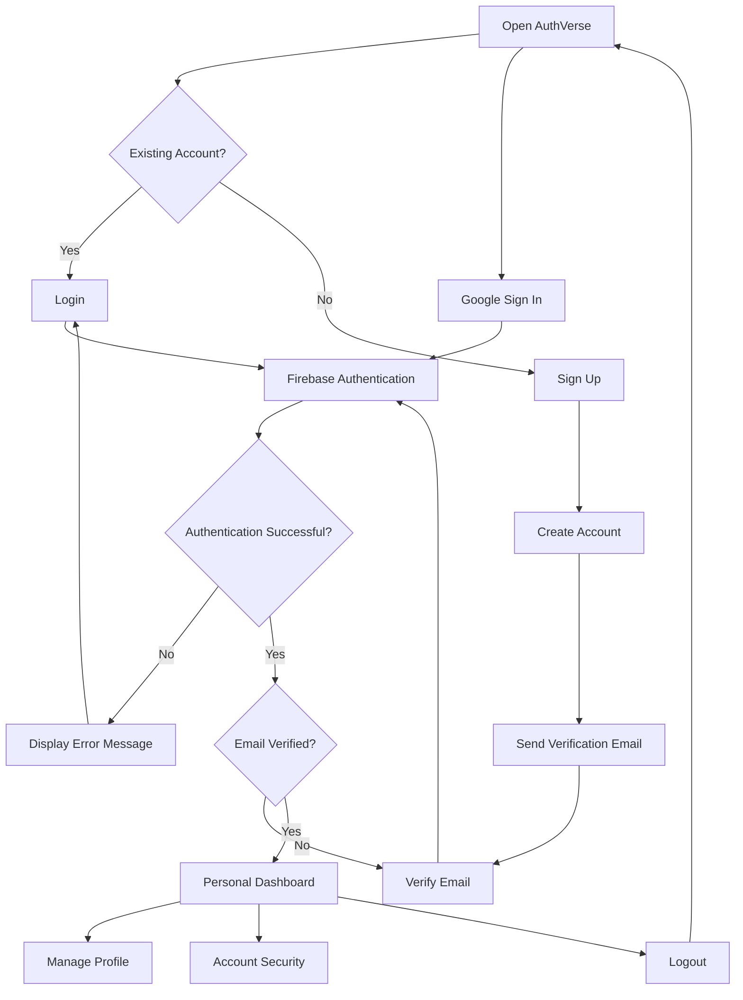

# 🛡️ AuthVerse — Your Secure Digital Gateway


## 📌 Project Overview

AuthVerse is a modern, interactive login authentication web application developed as part of the Oasis Infobyte Web Development and Designing Internship — Level 2, Task 4.

The application combines a futuristic neon-purple interface with Firebase Authentication to provide account registration, email verification, password recovery, Google sign-in and personalized account management.

Unlike a traditional static login page, AuthVerse integrates a cloud-based authentication service and provides a personalized dashboard for verified users.

> Your Identity. Your Access. Your World.

---

## 🌐 Live Demo

[Launch AuthVerse](https://bhagyasribolisetty2-dotcom.github.io/OIBSIP/WebDev-L2-LoginAuthentication/)

---

## ✨ Key Features

### 🔐 User Authentication

- Email and password registration
- Email and password login
- Google account authentication
- Email verification
- Password recovery through email
- Remember Me functionality
- Session management
- Secure logout using Firebase Authentication

### 🎨 Modern User Interface

- Futuristic black and neon-purple theme
- Glowing authentication container
- Animated diagonal background
- Smooth Login and Sign Up transitions
- Floating input labels
- Animated background orbs
- Gradient buttons
- Interactive hover effects
- Responsive desktop, tablet and mobile layouts
- Reduced-motion accessibility support

### 🔑 Password Management

- Show and hide password functionality
- Password strength indicator
- Minimum password length validation
- Confirm password validation
- Password reset email functionality
- User-friendly validation messages

### 👤 Personalized Dashboard

- Personalized welcome message
- User profile name
- Registered email address
- Profile avatar
- Email verification status
- Authentication status
- Account creation date
- Last sign-in information
- Sign-in provider information
- Unique Firebase User ID
- Copy User ID functionality
- Edit profile functionality
- Account security settings
- Logout functionality

### ⚡ Interactive Experience

- Loading spinner during authentication
- Toast notifications
- Success and error messages
- Password recovery modal
- Email verification modal
- Animated page transitions

---

## 🛠️ Technologies Used

| Technology | Purpose |
|---|---|
| HTML5 | Website structure |
| CSS3 | Styling, animations and responsive design |
| JavaScript ES6+ | Application logic and interactions |
| Firebase Authentication | Cloud-based user authentication |
| Google OAuth | Google account sign-in |
| Font Awesome | Icons |
| Google Fonts | Poppins typography |
| Git | Version control |
| GitHub | Source code management |
| GitHub Pages | Static website hosting |

---

## 🎨 Design System

AuthVerse follows a futuristic cybersecurity-inspired design system.

| Colour | Hex Code | Purpose |
|---|---|---|
| Midnight Black | `#090610` | Main background |
| Deep Purple | `#10091B` | Surface |
| Electric Purple | `#8228EB` | Primary colour |
| Neon Lavender | `#B46AFF` | Highlights |
| Dark Violet | `#43108A` | Gradient effects |
| Neon Purple | `#913BFF` | Borders |
| Emerald Green | `#43E69A` | Success states |
| Crimson Pink | `#FF5577` | Error states |
| White | `#FFFFFF` | Primary text |

### Typography

- Font Family: Poppins
- Style: Modern, futuristic and minimal

---

## 📂 Project Structure

```text
WebDev-L2-LoginAuthentication/
│
├── index.html
├── style.css
├── script.js
├── firebase-config.js
├── dashboard.html
├── dashboard.js
├── README.md
│
└── screenshots/
    ├── login.png
    ├── signup.png
    ├── password-strength.png
    ├── forgot-password.png
    ├── email-verification.png
    ├── google-signin.png
    ├── dashboard.png
    ├── edit-profile.png
    ├── account-security.png
    └── mobile-view.png
```

---

## ⚙️ How It Works

### User Registration

1. The user opens the AuthVerse application.
2. The user selects Sign Up.
3. The user enters their name, email and password.
4. JavaScript validates the form.
5. Firebase creates the user account.
6. A verification email is sent.
7. The user verifies their email address.
8. The user is redirected to the personalized dashboard.

### User Login

1. The user enters their registered email and password.
2. Firebase validates the credentials.
3. The application checks email verification status.
4. Verified users are redirected to the dashboard.
5. Invalid credentials display an error message.

### Google Authentication

Users can authenticate using their Google account through the Firebase Google Authentication provider.

### Password Recovery

Users can request a password reset email by entering their registered email address in the Forgot Password form.

### Logout

Firebase ends the current authentication session and redirects the user back to the login page.

---

## 🔄 Authentication Flowchart



---

## 📸 Project Screenshots

### Login Page


### Sign Up Page


### Password Strength Indicator


### Forgot Password


### Email Verification


### Google Authentication


### Personalized Dashboard


### Edit Profile


### Account Security


### Mobile Responsive View


---

## 🚀 Running the Project Locally

### Step 1: Clone the Repository

```bash
git clone https://github.com/bhagyasribolisetty2-dotcom/OIBSIP.git
```

### Step 2: Navigate to the Project

```bash
cd OIBSIP/WebDev-L2-LoginAuthentication
```

### Step 3: Start the Local Server

```bash
python -m http.server 5500
```

### Step 4: Open the Website

Visit:

```text
http://localhost:5500/index.html
```

Alternatively, use the Live Server extension in Visual Studio Code.

### Important Note

AuthVerse uses JavaScript ES modules and Firebase Authentication.

Opening index.html directly through the file:/// protocol may prevent the JavaScript modules from loading.

A local HTTP server or deployed HTTPS website is recommended.

---

## 🔥 Firebase Configuration

AuthVerse uses Firebase Authentication for managing user accounts.

To configure your own Firebase project:

1. Visit the Firebase Console.
2. Create a Firebase project.
3. Register a web application.
4. Enable Email/Password authentication.
5. Enable Google authentication.
6. Configure authorized domains.
7. Copy the Firebase web app configuration.
8. Update firebase-config.js.
9. Run the project using a local server.

### Firebase Console

https://console.firebase.google.com/

---

## 🔒 Security and Privacy

- Authentication is handled by Firebase Authentication.
- User passwords are not manually stored in LocalStorage.
- Email verification is required before dashboard access.
- Firebase manages authentication sessions.
- Password reset links are delivered through Firebase.
- Form inputs are validated.
- Dashboard access is checked using Firebase authentication state.
- Unauthenticated users are redirected to the login page.
- Administrative credentials and service account private keys must never be committed to GitHub.

### Security Scope

This project demonstrates client-side authentication using Firebase.

The dashboard displays the authenticated user's Firebase account information. It does not implement a separate private application database or custom authentication server.

Client-side dashboard redirection is not a substitute for server-side authorization. Future private database features must be protected using appropriate Firebase Security Rules.

---

## 📚 Learning Outcomes

Through the development of AuthVerse, I gained practical experience in:

- Designing professional authentication interfaces
- Creating responsive web applications
- Advanced CSS animations
- JavaScript DOM manipulation
- JavaScript ES modules
- Asynchronous JavaScript
- Form validation
- Firebase integration
- Cloud-based authentication
- Google OAuth authentication
- Email verification
- Password recovery
- Authentication state management
- Session persistence
- User profile management
- Error handling
- Local development servers
- Git and GitHub
- GitHub Pages deployment
- Project documentation

---

## 🔮 Future Enhancements

- Multi-factor authentication
- Additional social login providers
- Dark and Light Mode customization
- Account deletion functionality
- Enhanced password security policies
- Login activity history
- Device and session management
- Firestore database integration
- Role-based access control
- Admin dashboard
- Custom verification email templates
- Improved security monitoring

---

## 🎓 Internship Details

| Category | Details |
|---|---|
| Organization | Oasis Infobyte |
| Internship | Web Development and Designing |
| Level | Level 2 |
| Task | Task 4 |
| Project | Login Authentication |
| Application | AuthVerse |
| Development Environment | Visual Studio Code |
| Authentication Service | Firebase |
| Hosting Platform | GitHub Pages |

---

## 👩‍💻 Developer

Developed by Bhagya Sri

As part of the Oasis Infobyte Web Development and Designing Internship.

### GitHub

https://github.com/bhagyasribolisetty2-dotcom

### Internship Repository

https://github.com/bhagyasribolisetty2-dotcom/OIBSIP

---

## 🙏 Acknowledgements

Special thanks to:

- Oasis Infobyte
- Firebase
- Google
- Font Awesome
- GitHub
- Visual Studio Code

For providing the tools, resources and learning opportunities that supported the development of this project.

---

## 📝 Conclusion

AuthVerse demonstrates how modern frontend technologies can be integrated with a cloud-based authentication service to create an interactive and functional web application.

The project combines a futuristic visual experience with user registration, login, email verification, password recovery and personalized account management.

It represents an important step in my journey toward becoming a skilled web developer.

---

⭐ If you find this project interesting, consider giving the repository a star!

### AuthVerse

**Your Identity. Your Access. Your World.**

Made with 💜, creativity and JavaScript.
